# Geometry Browser

## Table of Contents
* [FireworksWeb Geometry Gateway](#fireworksweb-geometry-gateway)
* [FireworksWeb Main Gateway](#fireworksweb-main-gateway)
* [Geometry Hierarchical Browser](#geometry-hierarchical-browser)
  * [New top node path](#new-top-node-path)
  * [Move up in the hierarchy](#move-up-in-the-hierarchy)
* [Overlap browser](#overlap-browser)
* [Producing geometry file](#producing-geometry-file)


## FireworksWeb Geometry Gateway
Visit fireworks.cern.ch/geo.html to view geometry without event data. 

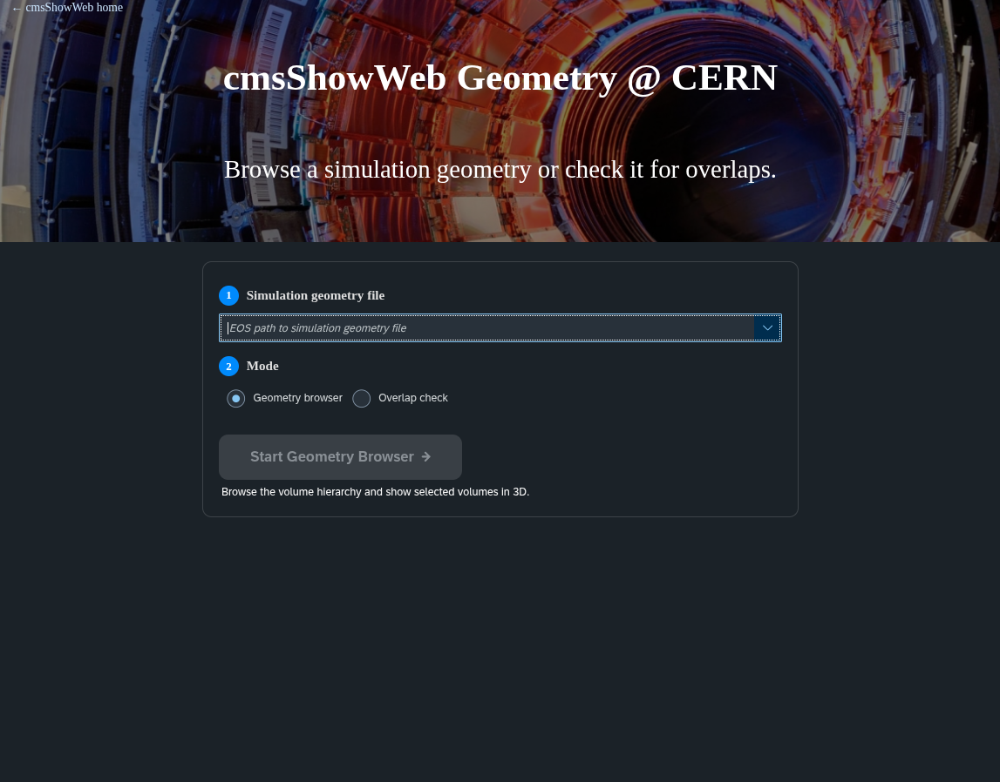

<br>

The input entry suggests possible geometries through the drop-down arrow. Alternatively, one can use any valid EOS path that is shared with the cms-vis-access group. See more details in [UserShare.md](UserShare.md).

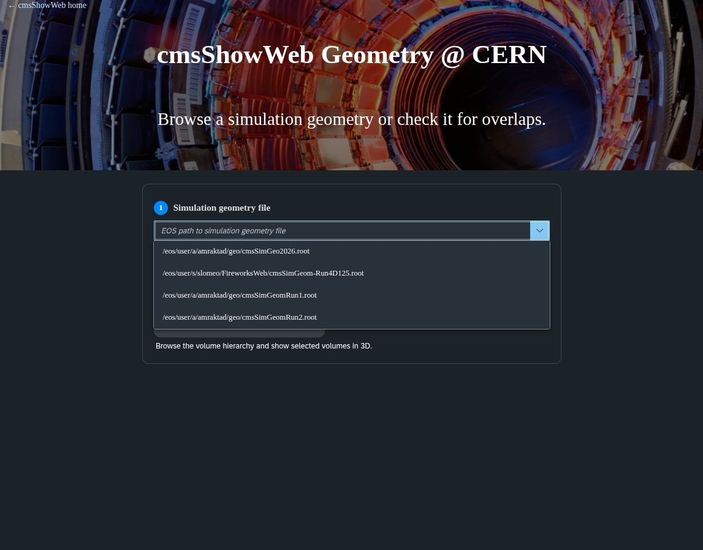

When the valid path is set, one can start an instance of the event display.

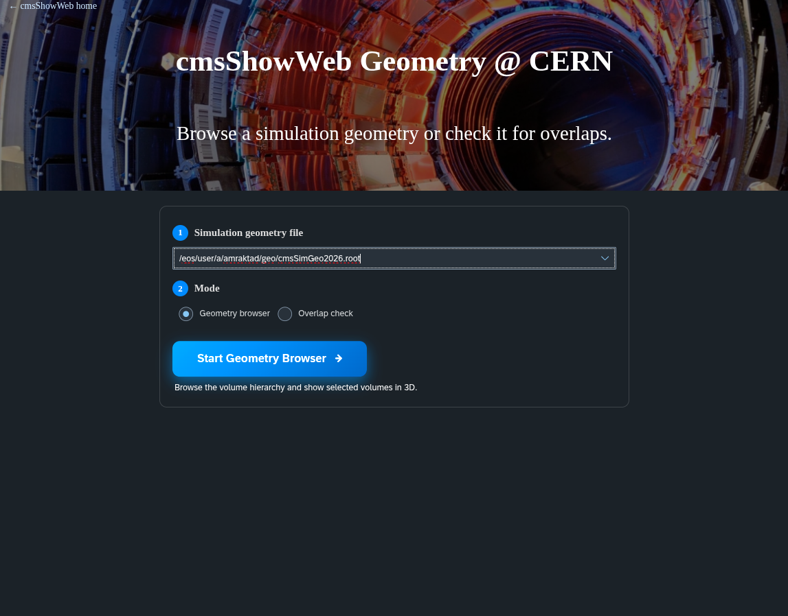


Through the gateway the event display needs a few seconds to start. You will see this text during the redirect.

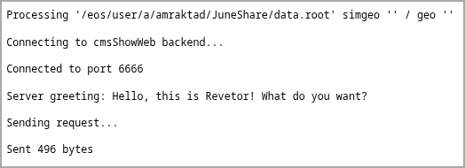


## FireworksWeb Main Gateway
The path to simulation file is specified in the optional input entry.
The 2 min video demonstrates the steps of gateway entry [link to youtube demo](https://youtu.be/3n1xOdsn_xw).


## Geometry Hierarchical Browser
The geometry sets the tracker geometry as the top node by default.
Use ‘Set As Top’ pop-up menu item to move down in the hierarchy.


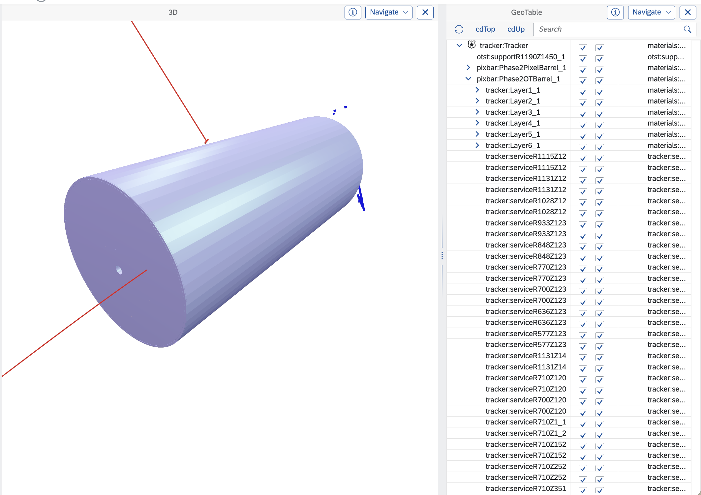

Right mouse click makes access to the pop-up menu in the geometry table:

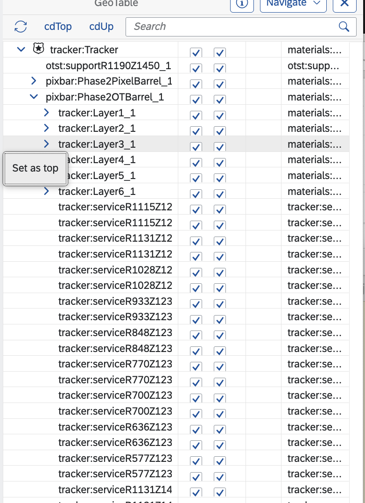

### New top node path
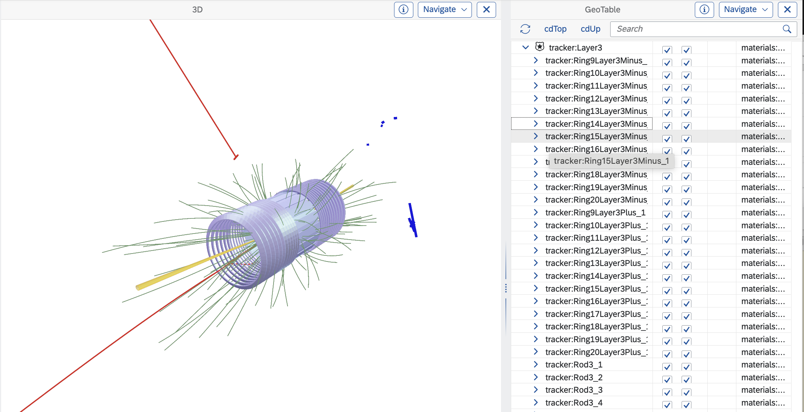


### Move up in the hierarchy
Use 'cdTop' or 'cdUp' button in the geometry table to move up.

 Screenshot when geo browser top node  is set to TGeoManager top node:
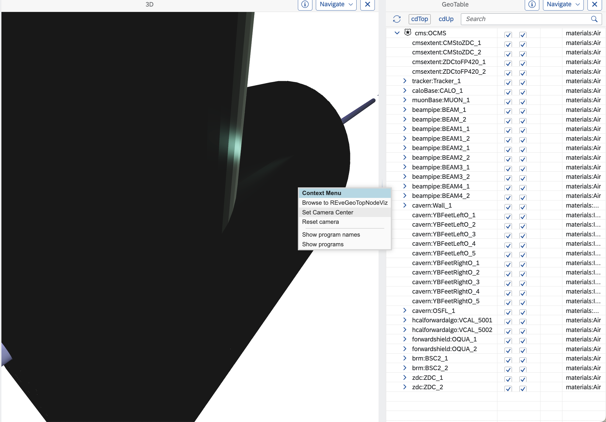
In cases where the bounding box span changes dramatically, one needs to reset the camera to have a proper camera view and lighting

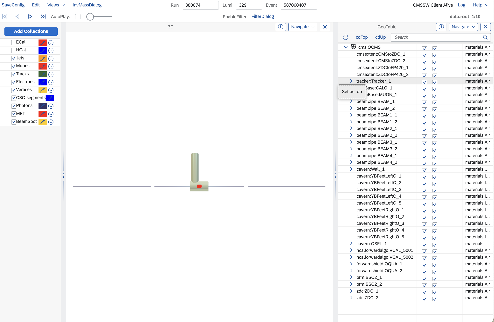


## Overlap browser

To view overlaps and extrusions, select 'Overlap check' mode in the geometry browser gateway.


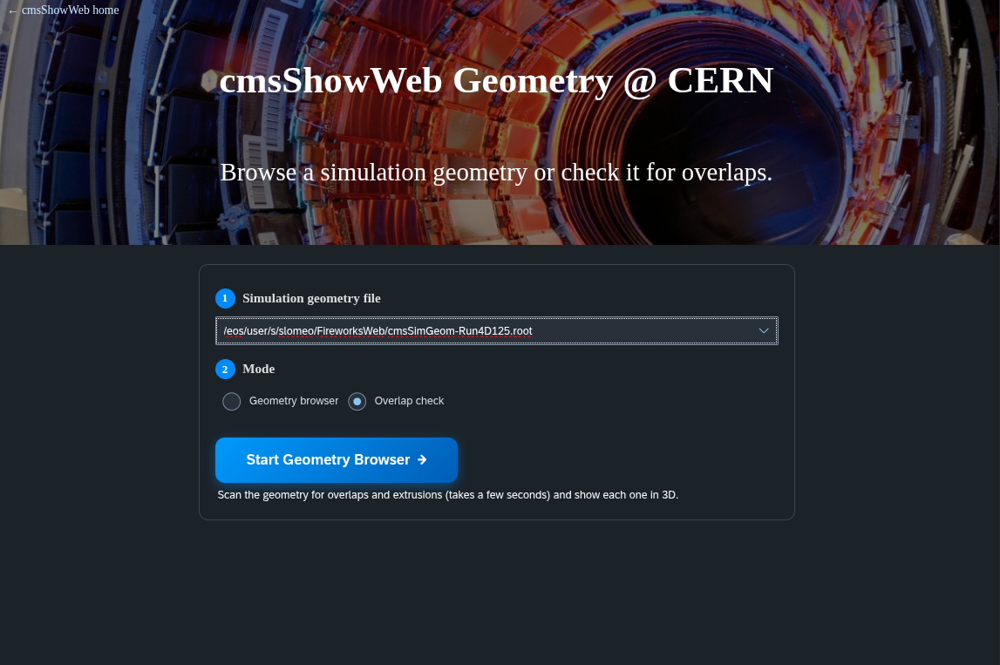


Below is an image of the overlap visualization. By selecting a row in the overlap table, the selected shapes will be drawn in the 3D view.


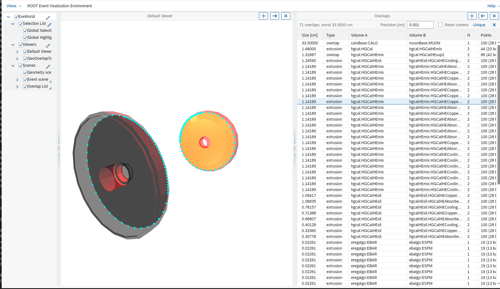


## Producing geometry file
Geometry files can be produced with `cmsRun`. The configuration scripts take a `tag` argument that specifies the geometry configuration.

**Simulation geometry**, output file `cmsSimGeo<tag>.root`:
```
cmsRun Fireworks/Geometry/python/dumpSimGeometry_cfg.py tag=<tag>
```

**Reconstruction geometry**, output file `cmsTGeoRecoGeom<tag>.root`:
```
cmsRun Fireworks/Geometry/python/dumpRecoGeometry_cfg.py tag=<tag>
```
