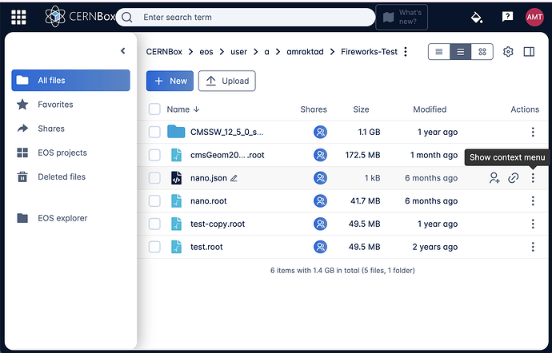
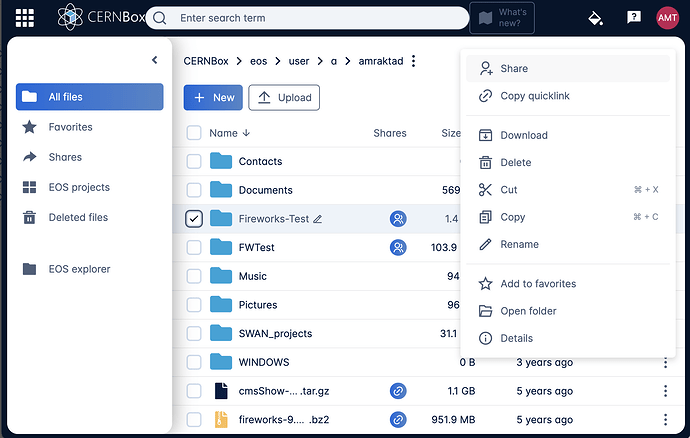
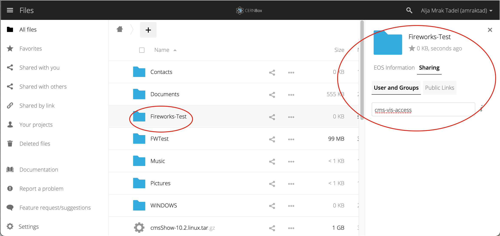

## Making data visible to the CMS web visualization service
Log in to CERNBox and select a folder to share. Choose the vertical triple dot icon to access the context menu.

Select the 'Share' action from the context popup menu.

Make the folder sharable with the cms-vis-access group.

